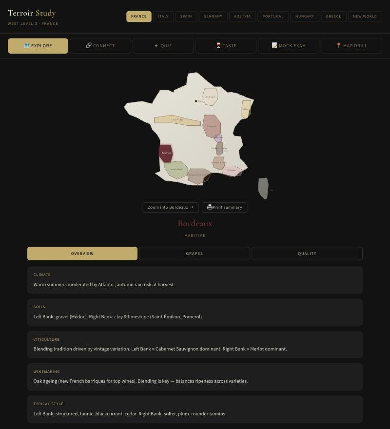
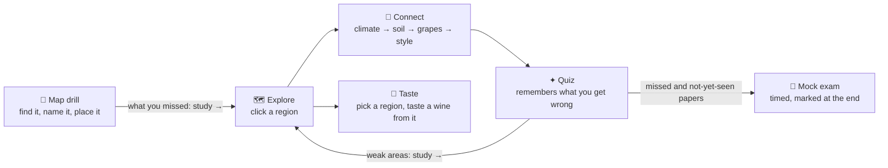
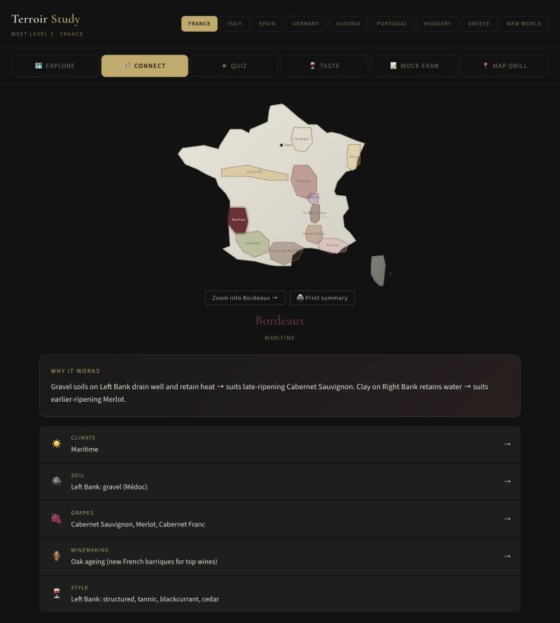
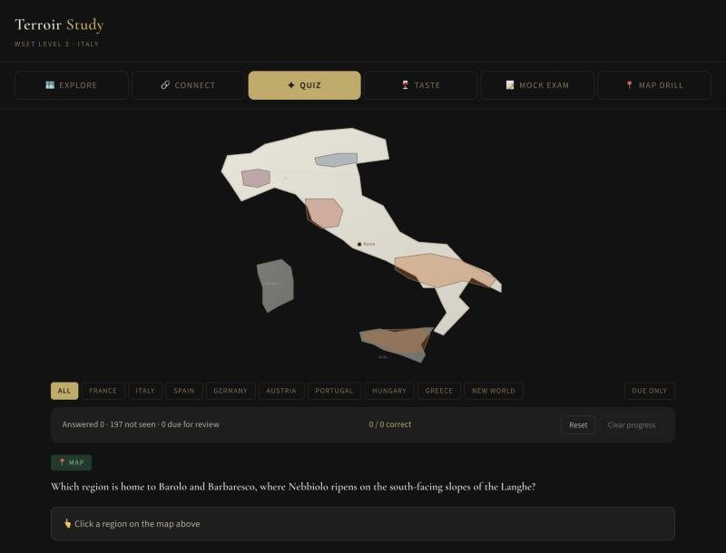
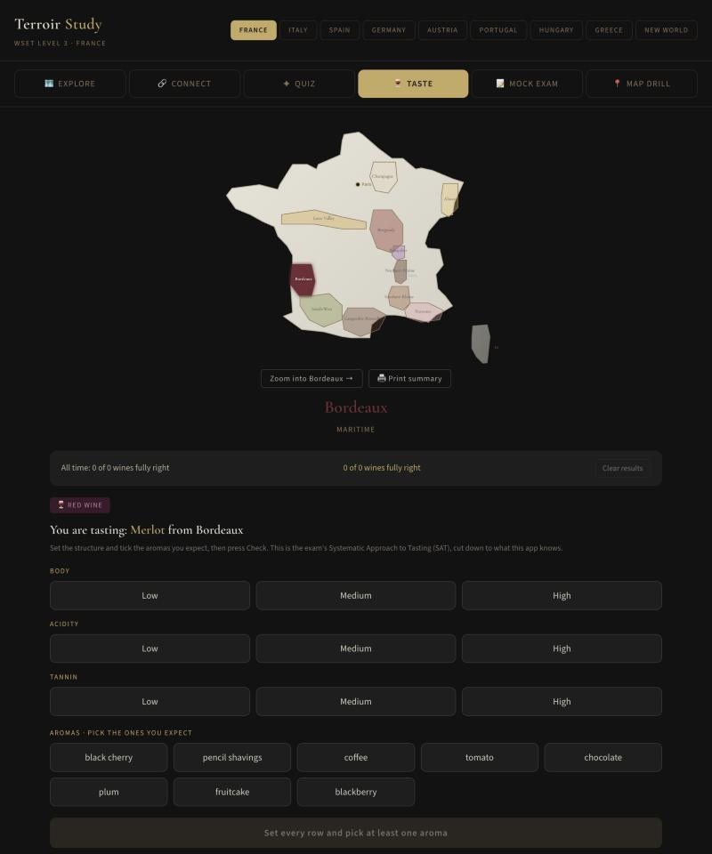
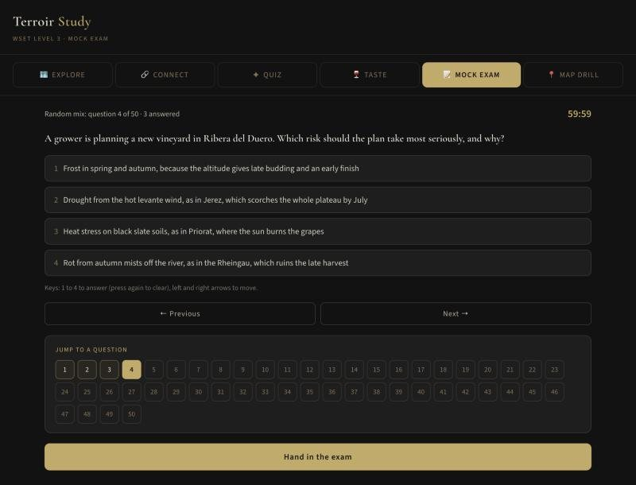
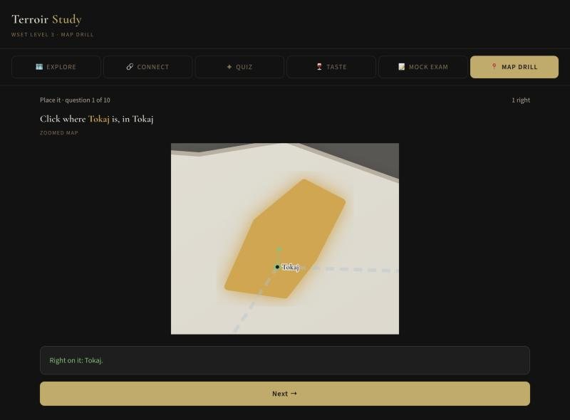
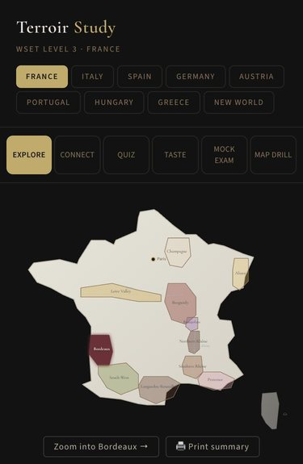
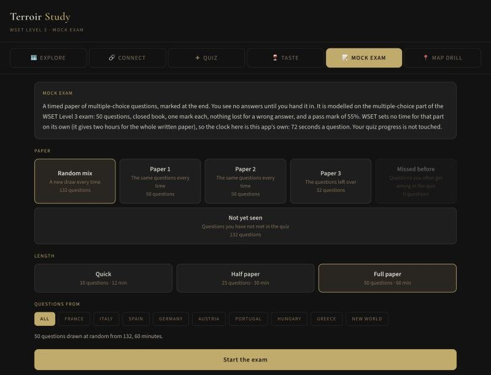

<div align="center">


# Terroir Study

**Learn where wine comes from by looking at the map.**
A visual study tool for WSET Level 3, built around maps, the reasons behind each region, and practice that remembers what you get wrong.

[](https://github.com/PKusch/terroir-study/actions/workflows/deploy.yml)


### [**→ Try it live**](https://pkusch.github.io/terroir-study/)

[What it does](#what-it-does) · [Screenshots](#screenshots) · [Regions](#regions-covered) · [How far to trust it](#how-far-to-trust-the-facts) · [Run it](#run-locally)

<br />



<br />

| 🌍 **9** countries | 🗺️ **74** regions | 📍 **352** places on the map | ❓ **494** quiz questions | 🍇 **112** grapes | ✅ **136** tests |
|:---:|:---:|:---:|:---:|:---:|:---:|

</div>

---

## The idea

### The problem

I'm studying for WSET Level 3 and discovered that every wine study app treats wine knowledge as text-based trivia. Flashcard apps ask "What is Burgundy's climate?" and expect you to recall a word. But wine is inherently **spatial** and **visual** — understanding *why* Merlot dominates Bordeaux's Right Bank requires seeing the clay soils, understanding the maritime climate, and connecting that to winemaking decisions.

The existing tools fail because they:
- Treat regions as isolated facts rather than connected systems
- Lack visual/spatial context (maps, climate overlays, soil relationships)
- Test recall instead of understanding
- Scatter information across flashcards with no coherent mental model

### The answer

Terroir Study is **map-first and connection-oriented**. Instead of memorising facts in isolation, you learn *why* each region works the way it does — from climate through to glass.

## What it does

Six ways to study, one map. Each one reads from the same data, so what you explore is what you are quizzed on.



The Quiz and Taste keep a record in your browser. The mock exam reads the quiz record to build its *Missed before* and *Not yet seen* papers, and the map drill and the exam save nothing.

## Screenshots

<table>
  <tr>
    <td align="center" width="33%"><br /><b>🗺️ Explore</b><br /><sub>Click a region, zoom into its villages, print a one-page summary</sub></td>
    <td align="center" width="33%"><br /><b>🔗 Connect</b><br /><sub>The chain from climate to glass, one link at a time</sub></td>
    <td align="center" width="33%"><br /><b>✦ Quiz</b><br /><sub>Map, connection and scenario questions with spaced repetition</sub></td>
  </tr>
  <tr>
    <td align="center"><br /><b>🍷 Taste</b><br /><sub>Body, acidity, tannin and aromas, marked against the grape</sub></td>
    <td align="center"><br /><b>📝 Mock exam</b><br /><sub>Timed paper, shuffled options, jump grid, marked at the end</sub></td>
    <td align="center"><br /><b>📍 Map drill</b><br /><sub>Click where Tokaj is; see your click, the real spot and the miss</sub></td>
  </tr>
</table>

<table>
  <tr>
    <td width="170"></td>
    <td valign="top">

**Works on a phone.** The six tabs and nine country buttons fit a small screen, the map scales to the width, and every drill works with a finger. Nothing is installed and nothing is sent anywhere: your progress stays in your browser, and a button at the foot of the page saves it to a file.

**Choose your paper.** The mock exam offers a random mix, three fixed numbered papers you can compare week to week, and papers built from what you have missed or not yet seen.



</td>
  </tr>
</table>

### What each mode does

**🗺️ Explore** — Click any region on the map of France, Italy, Spain, Germany, Austria, Portugal, Hungary, Greece or the New World, or pick it from the row of buttons under the map when the shapes are too small to click, then *Zoom into* it to see its villages and districts marked where they really are. *Print summary* gives a one-page revision sheet for the region on screen. See climate, soils, grapes, winemaking, and style in context. Browse sub-regions, grape varieties, and quality hierarchies.

**🔗 Connect** — The core differentiator. For each region, see the full chain: Climate → Soil → Grapes → Winemaking → Style. Understand *why* Champagne uses chalk soils, *why* Alsace is dry despite being northerly, *why* Chenin Blanc can be made in every style.

**✦ Quiz** — Three question types that test understanding, not just recall. Questions cover every region in the app, and the map switches to the country of the question:
- **Map questions** — "Click the region famous for galets"
- **Connection questions** — "Why is Merlot dominant on the Right Bank?"
- **Scenario questions** — "A Champagne producer wants a richer style. What would they do?"

Study everything or one country at a time, switch on *Due only* to drill just the questions you got wrong recently, and click any weak area to jump to that region's notes. On a multiple-choice question, press 1 to 4 to answer and Enter for the next one.

**🍷 Taste** — Tasting practice without a glass. The app names a wine it knows ("You are tasting: Nebbiolo from Piedmont"). You set its body, acidity and, for reds, tannin to low, medium or high, and tick the aromas you expect from eight words (the grape's own plus a few from other grapes of the same colour). Press Check and each row is marked against the grape profile, the aroma words turn green (right), red (wrong pick) or gold (missed), and a short "Why" card explains the answer from the grape and the region. Click a region on the map to taste a wine from there. This is the exam's Systematic Approach to Tasting, cut down to what the app has data for.

**📝 Mock exam** — A timed paper of multiple-choice questions, marked at the end. Choose a full paper (50 questions, like the multiple-choice part of the WSET Level 3 exam, which has a 55% pass mark and no marks lost for wrong answers), a half paper or a quick ten, and draw from every country or one. Papers 1 and 2 are frozen: they are the same every time and never change, even as questions are added, so you can compare scores from week to week. Paper 3 (and Paper 4, once there are enough questions) take everything else, and no question is on two papers. *Missed before* and *Not yet seen* build a paper from your quiz history. The options are shuffled, you see no answers until you hand in, and the clock hands the paper in for you at zero. The clock is this app's own, 72 seconds a question (60 minutes for a full paper): WSET gives two hours for its whole written paper and sets no time for the multiple-choice part alone. The result shows your score against the 55% pass mark, a split by country, and every question you missed with your answer, the right one and why. It never touches your quiz progress, and a paper in progress survives a trip to another tab.

**📍 Map drill** — Learn where things are, ten questions a round, for every country or one. *Find it* gives you a region's name and you click it on the map. *Name it* lights a region up and you pick its name from four. *Place it* gives you a village or district, such as Mád or Pauillac, and you click where it is on the zoomed map; a hit is within a twelfth of the map's width, and the answer is shown with a dot and a line to your click. At the end you see what you missed, with a link to study each one. It never touches your quiz progress.

## Regions Covered

| | Country | Regions |
|:-:|---|---|
| 🇫🇷 | **France** | Bordeaux · Burgundy · Northern Rhône · Southern Rhône · Loire Valley · Alsace · Champagne · Languedoc-Roussillon · Provence · South-West · Beaujolais |
| 🇮🇹 | **Italy** | Piedmont · Tuscany · Veneto · Southern Italy · Abruzzo · Marche · Umbria · Lazio · Friuli-Venezia Giulia · Trentino-Alto Adige |
| 🇪🇸 | **Spain** | Rioja · Ribera del Duero · Priorat · Sherry (Jerez) · Rías Baixas · Rueda · Cava (Penedès) · Penedès (still wines) · Toro · Navarra · Calatayud · Cariñena · Bierzo · Valencia · Jumilla · Yecla · La Mancha · Valdepeñas · Montsant · Catalunya |
| 🇩🇪 | **Germany** | Mosel · Rheingau · Pfalz · Nahe · Rheinhessen · Baden · Franken |
| 🇦🇹 | **Austria** | Niederösterreich · Burgenland · Steiermark |
| 🇵🇹 | **Portugal** | Vinho Verde · Douro · Alentejo · Dão · Bairrada · Lisboa |
| 🇭🇺 | **Hungary** | Tokaj · Eger · Villány |
| 🇬🇷 | **Greece** | Santorini · Naoussa · Nemea |
| 🌎 | **New World** | California · Australia · New Zealand · South Africa · Chile · Argentina · Oregon · Washington · New York · Ontario · British Columbia |

*Every country has its own hand-projected map, built from real latitude and longitude, with its capital, its main rivers and its neighbours drawn faintly. The quiz covers all of them.*

<details>
<summary><b>Region by region: what the app says about each</b></summary>

France (11 WSET L3 exam regions) with geographically accurate map, Paris as orientation marker, and major rivers:

- **Bordeaux** — Left Bank / Right Bank, Cabernet Sauvignon & Merlot blends
- **Burgundy** — Chablis through Mâconnais, Pinot Noir & Chardonnay terroir expression
- **Northern Rhône** — Côte-Rôtie, Hermitage, Syrah on steep granite slopes
- **Southern Rhône** — Châteauneuf-du-Pape, Grenache-based blends, galets
- **Loire Valley** — Muscadet, Vouvray, Sancerre, Chenin Blanc versatility
- **Alsace** — Riesling, Gewurztraminer, Vosges rain shadow
- **Champagne** — Chalk soils, méthode traditionnelle, marginal climate
- **Languedoc-Roussillon** — Bulk to quality revolution, Vin Doux Naturel
- **Provence** — Rosé capital, Bandol Mourvèdre
- **South-West** — Cahors Malbec, Madiran Tannat, micro-oxygenation origin
- **Beaujolais** — Gamay, 10 Crus on granite, carbonic maceration

Italy (4 WSET L3 exam areas) with its own map, Rome as orientation marker, the Po, and Sicily and Sardinia drawn in outline:

- **Piedmont** — Nebbiolo in Barolo and Barbaresco, Barbera, Dolcetto, Moscato d'Asti, Gavi; fog, Alps and calcareous marl
- **Tuscany** — Sangiovese from Chianti to Brunello, Bolgheri and the Super Tuscan story, galestro and alberese
- **Veneto** — Corvina and appassimento (Valpolicella, Ripasso, Amarone, Recioto), Soave, Prosecco by the tank method
- **Southern Italy** — Aglianico (Taurasi, Vulture), Fiano and Greco, Primitivo and Negroamaro, Etna and Marsala; heat moderated by altitude and sea

Spain (7 WSET L3 exam areas) with its own map, Madrid as orientation marker, the Ebro, and Portugal drawn in outline:

- **Rioja** — Tempranillo blends across Rioja Alta, Alavesa and Oriental; the Cantabrian shield, clay-limestone, and the Crianza–Reserva–Gran Reserva oak ladder
- **Ribera del Duero** — Tempranillo (Tinto Fino) at altitude on the Duero plateau; hot days, cold nights, frost, and darker, firmer wines than Rioja
- **Priorat** — Old-vine Garnacha and Cariñena on licorella slate terraces; tiny yields, concentrated reds, DOQ status
- **Sherry (Jerez)** — Palomino on albariza; Fino and Manzanilla under flor, Oloroso oxidative, Amontillado between, Pedro Ximénez sweet; the solera system
- **Rías Baixas** — cool, wet Atlantic Galicia on granite; Albariño on pergolas raised off the damp ground against fungal disease; tiny holdings; the 100% Albariño and 70% rules, five sub-zones, Barrica and bottle-fermented sparkling (from the DO's 2024 specification)
- **Rueda** — Verdejo on a high Duero plateau with cold winters, late frosts and a big day–night swing; stony soils, machine harvest at night against oxidation; the 2024 rule that principal varieties make at least 75%; Dorado and sparkling
- **Cava (Penedès)** — traditional-method sparkling around Sant Sadurní d'Anoia; Macabeo, Xarel·lo and Parellada; at least 9 months on the lees for Guarda, 30 for Gran Reserva and 36 for Paraje Calificado; dosage from Brut Nature to Dulce

Germany (3 WSET L3 exam regions) with its own map, Berlin as orientation marker, the Rhine and the Mosel, and the neighbouring countries drawn faintly:

- **Mosel** — Riesling on steep, south-facing slate above the river; cool, light, high-acid, off-dry to sweet; the Prädikat ladder from Kabinett to Trockenbeerenauslese and Eiswein
- **Rheingau** — Riesling where the Rhine turns west; warmer and drier, fuller dry wines and VDP Grosses Gewächs; Spätburgunder at Assmannshausen; botrytis sweet wines
- **Pfalz** — warm and dry in the rain shadow of the Haardt (the Vosges continued); riper dry Riesling, Grauburgunder, Weissburgunder, Spätburgunder, Dornfelder

Austria (3 WSET L3 exam areas) with its own map, Vienna as orientation marker and the Danube:

- **Niederösterreich** — Grüner Veltliner and Riesling along the Danube: Wachau, Kremstal, Kamptal, Wagram, Traisental and the Weinviertel; hot days and cold nights, primary rock terraces and loess; Steinfeder, Federspiel and Smaragd, and the DAC system
- **Burgenland** — warm, dry Pannonian climate; Zweigelt and Blaufränkisch (Mittelburgenland, Eisenberg, Leithaberg, Neusiedlersee); autumn mist off the shallow Neusiedler See brings noble rot and the sweet wines of Rust
- **Steiermark** — Austria's cool, hilly south; Sauvignon Blanc, Welschriesling and Morillon, Schilcher rosé from Blauer Wildbacher, and the Gebietswein–Ortswein–Riedenwein pyramid

Portugal (3 WSET L3 exam areas) with its own map, Lisbon as orientation marker, the Douro and the Tejo, and Spain drawn faintly:

- **Vinho Verde** — the wet, cool northwest; light, low-alcohol, high-acid whites from Alvarinho (best in Monção e Melgaço), Loureiro and Arinto; vines trained high on pergolas for air; granite soils
- **Douro** — terraced schist slopes along the river; Touriga Nacional, Touriga Franca and Tinta Roriz; Port (fortified with grape spirit, Ruby, Tawny, LBV, Vintage) and Douro table wine; Baixo Corgo wettest, Douro Superior hottest and driest
- **Alentejo** — the hot southern plain; soft, fruity Aragonez, Trincadeira and Alicante Bouschet, Antão Vaz and Arinto whites; cork oak, vinho de talha in clay amphorae, and eight DOC sub-regions

Hungary (3 WSET L3 exam areas) with its own map, Budapest as orientation marker, the Danube and the Tisza:

- **Tokaj** — Furmint and Hárslevelű where the Bodrog meets the Tisza; river mist then dry sun brings noble rot; dry Furmint, Szamorodni, Aszú (at least 120 g/l of sugar, with the optional 5 and 6 puttonyos terms) and Eszencia; volcanic soils
- **Eger** — cool northern foothills of the Bükk; Egri Bikavér, "Bull's Blood", led by Kékfrankos, in three tiers (Classicus, Superior, Grand Superior), and the Egri Csillag white blend
- **Villány** — the warmest corner, in the far south; Cabernet Franc and Bordeaux-style reds on limestone and loess; Classicus, Premium and Super Premium tiers

Greece (3 WSET L3 exam areas) with its own map, Athens as orientation marker, Crete and the islands drawn in outline:

- **Santorini** — a hot, dry, windy volcanic island; Assyrtiko (at least 85% in dry PDO wines) from old ungrafted vines trained in low baskets (kouloura); Nykteri and the sweet Vinsanto
- **Naoussa** — the eastern slopes of Mount Vermio; Xinomavro, "acid black", high in acidity and tannin and often compared with Nebbiolo; red only under the PDO
- **Nemea** — the Peloponnese hills; Agiorgitiko, red only under the PDO, soft and plummy in the warm lowlands and fresher at altitude (the three altitude zones, about 200 to 850 metres, are informal)

New World (11 regions in 9 countries, one small map tile each) sharing one map:

- **California** — Napa Cabernet, Sonoma Pinot Noir and Zinfandel, Santa Barbara and Paso Robles, Central Valley volume; Pacific fog through gaps in the Coast Ranges decides the style, and an AVA is a place name, not a quality mark
- **Australia** — Barossa Shiraz from old ungrafted vines, Eden and Clare Riesling at altitude, Coonawarra Cabernet on terra rossa, Hunter Sémillon picked early to age, Margaret River and Yarra; Murray irrigation for volume; the GI system
- **New Zealand** — Marlborough Sauvignon Blanc from long sunny days and cool nights, Central Otago Pinot Noir at the world's southern limit, Hawke's Bay Syrah and Bordeaux blends on the Gimblett Gravels, Martinborough; screwcaps everywhere
- **South Africa** — Stellenbosch Cabernet and Bordeaux blends, Chenin Blanc as the most planted grape, Pinotage (Pinot Noir × Cinsault), the Benguela current and the Cape Doctor, Walker Bay and Elgin for cool-climate Pinot and Chardonnay, Swartland bush vines; Wine of Origin
- **Chile** — the Pacific (Humboldt current) and the Andes as the two coolers, Casablanca and San Antonio whites, Maipo Cabernet, Colchagua Carmenère (the Bordeaux grape mistaken for Merlot), Central Valley volume; ungrafted vines, no phylloxera
- **Argentina** — Mendoza Malbec at altitude (Luján de Cuyo, Uco Valley), desert climate irrigated by Andean meltwater, the zonda wind and hail, thick skins from strong sunlight, Torrontés from high-altitude Salta; Cabernet and Bonarda
- **Oregon** — Willamette Valley Pinot Noir behind the Coast Range rain shadow; Jory volcanic soil in the Dundee Hills, marine sediment and Laurelwood loess elsewhere
- **Washington** — Columbia Valley in the rain shadow of the Cascades, 6 to 8 inches of rain, irrigated desert on basalt, Missoula flood deposits and loess; Cabernet Sauvignon and Riesling lead
- **New York** — Finger Lakes Riesling and Cabernet Franc; the deep lakes keep winter cold from killing the vines
- **Ontario** — Niagara Peninsula between the escarpment and the lake, VQA labelling by area, and Icewine picked below -8 °C
- **British Columbia** — the Okanagan Valley in the rain shadow of the Coast Mountains; irrigated, with Icewine rules of its own

</details>

## How far to trust the facts

The region facts, grape profiles and quiz questions were first written from memory, and in October 2026 they were checked against real sources: WSET's own pages for the exam format, Wines of Greece, Vinea Wachau, the Châteauneuf-du-Pape, Rioja, Valpolicella, Prosecco and New Zealand Winegrowers sites, Wine Folly, Decanter and Wikipedia. That found real mistakes, which are fixed (for example that Tokaj dropped Aszúeszencia in 2013, and the Champagne lees ageing minimums).

It is not a substitute for your course book. Many official pages could not be read, so some points rest on secondary sources, and where sources disagreed the number was left out rather than guessed. Still unchecked: Soave and Bolgheri soils, the Vin Santo barrels, bush vines in Puglia, Elgin and Stellenbosch soils, how far Coonawarra is from the sea, and the legal ageing minimums for Naoussa and Nemea Reserve. The mock exam's 50 questions and 55% pass mark are WSET's published format; its 72-seconds-a-question clock is this app's own, because WSET gives two hours for the whole written paper and no time for the multiple-choice part alone.

Rías Baixas, Rueda and Cava were researched separately, from the rule books themselves where they could be read: the Rías Baixas DO's 2024 specification, Rueda's own site, and the Cava specification. Left out because the sources disagreed or could not be read: Cava Reserva's minimum ageing (one text says 15 months, newer ones 18), the Penedès altitude bands, how Corpinnat split from Cava, the exact Rueda tiers before the 2024 change, and Rueda's minimum alcohol (the DO's own pages give two figures).

The regions added later (Toro and Navarra, Calatayud and Cariñena, Bierzo, Valencia, Jumilla, Yecla, La Mancha, Valdepeñas, Montsant, Catalunya, Nahe, Rheinhessen, Baden, Franken, the extra Italian and Portuguese ones, and the extra New World ones) were each built from the official rule book or specification where it could be read, then every quiz question was checked a second time by a separate pass against the same kind of source. That second pass found a few real mistakes, now fixed: the Franconian "fränkisch trocken" sugar limit is 4 g/L, not 5, and the sub-zones of Colli Orientali del Friuli are Cialla plus four named for a grape and a village. Anything it could not confirm was reworded, softened or dropped. The weakest spots are the Dão, Bairrada and Lazio regions and the Oregon, Washington, Finger Lakes, Ontario and British Columbia ones, where the official pages would not load and a wine-reference site or Wikipedia stands in. The rule is simple: a number is only in the app if a page said it.

A list of which regions the WSET Level 3 specification names, and which of them the app has, is in [docs/COVERAGE.md](docs/COVERAGE.md).

## Tech Stack

- **React 18** — Component-based UI with hooks
- **Vite** — Fast build tooling
- **Custom SVG map** — Geographically projected from real lat/lon coordinates (not a library)
- **GitHub Pages** — Automated deployment via GitHub Actions
- **No external UI libraries** — All components built from scratch

## Keeping your progress

Your quiz record and tasting results live in the browser you are using and nowhere else.
Clearing the browser's site data, or opening the tool on another phone or laptop, starts
you from nothing. At the foot of the page, **Save progress file** downloads everything as
one small file, and **Restore from file** loads it back. Restoring says what is in the file
and asks first. It adds to what is already there and keeps the more recent answer for any
question in both, so restoring the same file twice changes nothing, and a file that is not a
backup, or is damaged, is refused. **Clear progress** and **Clear results** need a second click. The mock exam and the map drill save nothing at all: they are practice, and the only thing they read is your quiz record, to build the *Missed before* and *Not yet seen* papers.

## Keyboard and screen readers

You can study without a mouse. Tab moves between the map regions and buttons, and
Enter or Space picks one. In the quiz, 1 to 4 answer and Enter moves on. In a mock exam, 1 to 4 pick an answer (press again to clear it) and the left and right arrows move between questions. In the map drill, 1 to 4 answer *Name it* and Enter moves on. *Find it* and *Place it* need a mouse or a finger, because a keyboard cannot point at a spot on a map. Selected buttons say so out loud, the quiz says "Correct" or
gives the right answer in words as well as colour, and animation switches off if your
device is set to reduce motion. During a map quiz the region names are kept from screen
readers, because the name is the answer.

## Run Locally

```bash
git clone https://github.com/PKusch/terroir-study.git
cd terroir-study
npm install
npm run dev
```

## Roadmap

- [x] Italy (Piedmont, Tuscany, Veneto, Southern Italy)
- [x] Spain (Rioja, Ribera del Duero, Priorat, Sherry, Rías Baixas, Rueda, Cava)
- [x] Germany (Mosel, Rheingau, Pfalz, Nahe, Rheinhessen, Baden, Franken)
- [x] Austria (Niederösterreich, Burgenland, Steiermark)
- [x] Portugal (Vinho Verde, Douro, Alentejo)
- [x] Hungary (Tokaj, Eger, Villány)
- [x] Greece (Santorini, Naoussa, Nemea)
- [x] New World (California, Australia, New Zealand, South Africa, Chile, Argentina, Oregon, Washington, New York, Ontario, British Columbia)
- [x] Expand quiz bank to 50+ questions (494: 63 France, 65 Italy, 142 Spain, 46 Germany, 18 Austria, 38 Portugal, 17 Hungary, 17 Greece, 88 New World; 396 of them multiple choice)
- [x] Spaced repetition algorithm for quiz mode
- [x] Grape variety profiles with tasting descriptors (112 grapes)
- [x] Systematic Approach to Tasting (SAT) practice mode (Taste mode: structure and aromas marked against the grape profiles)
- [x] Progress tracking and weak-area identification
- [x] Map drill: find it, name it and place it, with a round score and a study list
- [x] Mock exam mode: timed multiple-choice paper, shuffled options, 55% pass mark, results by country and a review of every miss
- [x] Facts fact-checked against sources, with the gaps listed above
- [x] Sub-region drill-down maps (Zoom into any region: 352 places marked across 74 regions)

## About

Built by someone actively studying for WSET Level 3 who got frustrated with existing tools. This is the app I needed but couldn't find.

## Tests

```bash
npm test
```

136 tests cover the pure logic with no browser needed: progress and spacing, the taste marker, backups, summaries, the map maths, the region and quiz data (every question points at a real region, every place lands on its region, every grape has a profile), the mock exam (building, shuffling, fixed papers, marking against the pass mark) and the map drill (rounds, placing a click, scoring).

## License

MIT
